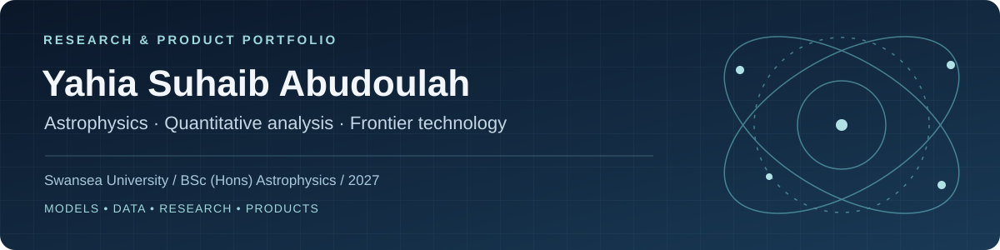
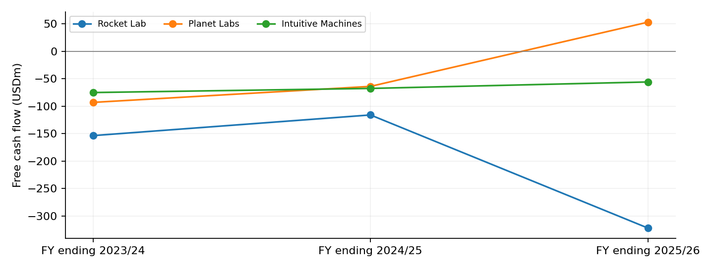
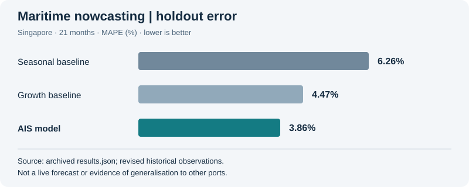
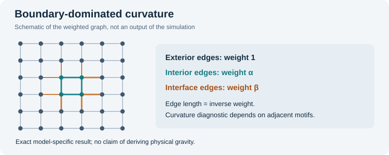

[Finance and alternative data](#finance-and-alternative-data) | [Scientific research](#scientific-research) | [Product development](#product-development) | [Professional development](#professional-development)

I'm a final-year astrophysics student at Swansea University, graduating in June 2027. My interests include gravitational physics, astronomical data analysis and the economics of space technology. This repository brings together my research interests, project work and development prototypes.

## Selected work

| Project | Files | Highlights |
|---|---|---|
| **[Commercial Space Economics](space-economics/)** | [Excel model](space-economics/Space_Economics_Model.xlsx) · [Report](space-economics/Space_Economics_Report.pdf) · [Python](space-economics/analyze.py) | Three companies, nine funding scenarios |
| **[Orbit Intelligence](orbit-intelligence/)** | [Python](orbit-intelligence/analyze.py) · [Model results](orbit-intelligence/results.json) | 93 monthly observations; 3.86% historical holdout MAPE |
| **[Boundary-source gravity framework](astrophysics/emergent-gravity/)** | [14 toy models](astrophysics/emergent-gravity/toy_models/) · [Recorded results](astrophysics/emergent-gravity/results/) | 51 canonical scripts, exact motif law and continuum tests |
| **[GhostHunter](astrophysics/ghosthunter/)** | [v11.1 detector](astrophysics/ghosthunter/GHOSTHUNTER_V11_1_DISCOVERY_PILOT_FIXED.py) · [Candidate data](astrophysics/ghosthunter/results/followup_six_candidates.csv) | Low-surface-brightness candidate screening |
| **[ZTF & ATLAS](astrophysics/ztf-atlas/)** | [Python analysis](astrophysics/ztf-atlas/GHOSTHUNTER_TIME_DOMAIN_SPRINT.py) · [Independent check](astrophysics/ztf-atlas/results/atlas_independent_report.json) | Period searches and cross-survey checks |
| **[LAMOST stellar analysis](astrophysics/lamost/)** | [Portable reproduction script](astrophysics/lamost/analyze.py) · [Historical findings](astrophysics/lamost/recorded_results.json) | Historical mass–luminosity exponent ≈3.46 |
| **[ATHAR](athar/)** | [Development case study](athar/README.md) · [Geometry QA](athar/geometry-qa.md) | Student-focused web product, 11-room world prototype |
| **[BLACKOUT](blackout/)** | [Product case study](blackout/README.md) | Immersive narrative mobile application concept |
| **[Standard Chartered](professional-development/)** | [Simulation overview](professional-development/README.md) · [Completion record](professional-development/completion-record.md) | Corporate credit analysis, Forage |

## Finance and alternative data

### Commercial Space Economics

How do different space-sector business models fund growth? The model compares Rocket Lab, Planet Labs and Intuitive Machines using published annual disclosures, then tests five-year cash-flow sensitivity under downside, base and upside assumptions.

[Research report](space-economics/Space_Economics_Report.pdf) · [Excel workbook](space-economics/Space_Economics_Model.xlsx) · [Source data and methodology](space-economics/)

### Orbit Intelligence

A historical maritime nowcasting experiment combining AIS and official Singapore container throughput. The test uses a chronological holdout rather than a random split.

[Model code](orbit-intelligence/analyze.py) · [Results](orbit-intelligence/results.json) · [Reproduction and provider sources](orbit-intelligence/)

## Scientific research

### A Boundary-Source Toy Framework for Emergent Weak-Field Gravity

A 14-model research programme investigating weighted-network defects, boundary curvature, microscopic dynamics and continuum reconstruction. The July verification archive reports direct graph and symbolic agreement across 1,125 parameter points. The familiar field equations are effective inputs, not a derivation of general relativity.

[Research overview](astrophysics/emergent-gravity/) · [All 14 toy models](astrophysics/emergent-gravity/toy_models/) · [Numerical results](astrophysics/emergent-gravity/results/)

### Astronomical data analysis

**GhostHunter** screens low-surface-brightness galaxy candidates and examines detector performance and source identity. **ZTF & ATLAS** tests time-domain signals using independent survey data, controls and quality cuts; the candidate signals remain unconfirmed. **LAMOST** examines the empirical mass–luminosity relation of FGK stars.

[GhostHunter](astrophysics/ghosthunter/) · [Time-domain research](astrophysics/ztf-atlas/) · [Stellar analysis](astrophysics/lamost/)

## Product development

| [ATHAR](athar/) | [BLACKOUT](blackout/) |
|---|---|
| Student productivity, career evidence and an interactive world-inspired interface. An October prototype tests an 11-room reference layout. | Immersive horror storytelling, sound, investigations and vintage editorial design. Mobile concept in development. |

Source code and licensed assets for both apps are private.

## Professional development

[**Standard Chartered Credit Analyst Job Simulation (Forage)**](professional-development/) · completed 19 November 2026. Simulated client financial assessment, credit risk, industry research and a lending recommendation presentation; not bank employment.

## Methods & tools

Python · NumPy · SciPy · pandas · Matplotlib · Astropy · Excel · statistical modelling · time-series analysis · financial statements · scenario analysis · React/Vite/Phaser product prototyping

## Data and reproduction

The project pages document sources, assumptions and limitations. The gravity manuscript is unpublished, and the commercial models are exploratory prototypes pending independent reproduction. The LAMOST script reconstructs the analysis workflow; the original dataset is not included.

See [dependencies](requirements.txt) and [data and provenance](DATA_AND_REUSE.md) for further details.
