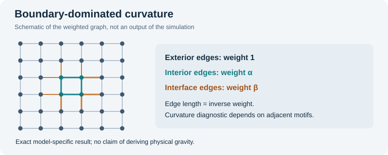

# A Boundary-Source Toy Framework for Emergent Weak-Field Gravity from Information-Network Defects

**Version 3.0 | 3 July 2026 | Unpublished research manuscript**

A weighted-network toy model of a localised defect and its interface with the surrounding network. The research examines whether the source-like curvature response can be reconstructed from boundary motifs, how that response behaves under microscopic dynamics and coarse-graining, and whether it can support familiar weak-field observables through an effective field equation.

## Research programme

The original manuscript describes 14 successive models. This collection contains 51 canonical simulation scripts selected from the archived July reproduction package. Corrected variants are preferred over superseded attempts. Model 2 is deliberately retained as a negative result, not counted as a successful derivation of bending.

| Model | Investigation | Recorded outcome |
|---|---|---|
| [01. Network geometry](toy_models/toy_01/) | Path-count law and exact motif-based curvature response. The critical boundary value at α = 4 is approximately 0.25. | PASS |
| [02. Static halo limitation](toy_models/toy_02/) | Static shortest-path bending did not reproduce smooth weak-field scattering. This negative result motivates the dynamical model. | CHECK |
| [03. Dynamic particle bending](toy_models/toy_03/) | Time-dependent scattering and network-source scaling; 72/72 reported inverse-impact-parameter tests. | PASS |
| [04. Poisson field bridge](toy_models/toy_04/) | Effective source feeds an inserted Poisson equation. Model 4b reports 72/72 cases, with external force exponent near 2. | PASS |
| [05. Multiple sources](toy_models/toy_05/) | Field and force superposition near machine precision; binary robustness 24/24. | PASS |
| [06. Weak-field metric](toy_models/toy_06/) | Inserted metric, light deflection, clock rate, redshift and time delay; 84/84 clock/redshift/delay groups. | PASS |
| [07. Linearised Einstein-like consistency](toy_models/toy_07/) | Source scaling, spatial components and Bianchi consistency checks within the inserted metric; 45/45 multi-source groups. | PASS |
| [08. Retarded propagation](toy_models/toy_08/) | Moving sources and finite propagation speed; 64/64 continuity groups, 9/9 propagation cases and 27/27 quadrupole categories. | PASS |
| [09. Energy flux and backreaction](toy_models/toy_09/) | 189/189 flux cases, 12/12 orbital-backreaction groups and 12/12 fixed chirp reconstruction tests. | PASS |
| [10. Tensor waves and detector response](toy_models/toy_10/) | Transverse-traceless and detector wrappers; 7/7 antenna-response checks and 10/10 detector failure-domain behaviours. | PASS |
| [11. Boundary-action source rule](toy_models/toy_11/) | Motif-count coefficients, boundary-action stability and explicit invalid cases; 25/25 equilibrium groups and 10/10 failure-domain behaviours. | PASS |
| [12. Microscopic dynamics](toy_models/toy_12/) | Edge relaxation and seeded conserved-charge defect formation; 15/15 dynamics, 11/11 failure behaviours and 4/4 final defect groups. | PASS |
| [13. Continuum reconstruction](toy_models/toy_13/) | Resolution scaling, line-measure-preserving coarse-graining and continuum source reconstruction; 10/10 coarse groups and 12/12 failure-domain behaviours. | PASS |
| [14. Unified capstone](toy_models/toy_14/) | Connects microscopic defect formation, boundary source, continuum reconstruction and the inserted weak-field bridge; 12/12 expected validity/failure behaviours. | PASS |

## Core mathematics

For the weighted graph, exterior edges have weight 1, interior edges have weight α, and boundary edges have weight β. Edge length is defined as the reciprocal of weight. A path with exterior, interior and boundary step counts has length:

$$L=N_{out}+N_{in}/\alpha+N_{\partial}/\beta.$$

For a central crossing with 20 exterior, eight interior and two interface edges, the zero-epsilon critical coupling is β = 2/(10−8/α), yielding β = 0.25 at α = 4. The critical value depends on the path geometry.

The graph-curvature excess is resolved into adjacent-edge motifs. Under the prescribed edge classification, the pure outside/inside channels cannot be directly adjacent and the corresponding coefficients vanish. Interface terms therefore control the baseline-corrected response within this chosen model.

## Main findings

- Exact path-count relation and critical boundary-coupling calculation.
- Exact motif-count reconstruction of the graph-curvature diagnostic.
- Stable seeded defects and source-free empty controls.
- Resolution and boundary-normalised coarse-graining tests within their validity domains.
- A unified pipeline with explicit checks of invalid inputs.

[Recorded numerical results](results/model_status.csv) | [Later July verification table](results/verification_summary.csv) | [Critical coupling comparison](results/critical_beta.csv)

## Reproduction

Install the dependencies from [requirements.txt](requirements.txt). Each numbered directory includes the canonical Python scripts and a short explanation. Inspect the parameters and output settings before running. Scripts containing large numerical sweeps can take considerable time.

The original supplementary audit records fresh and archived checks of the principal findings, but one uninterrupted full-suite run did not finish. These files have been transferred from the research archive, not rerun here.

## Scope

The exact results concern the specified weighted graph and Forman-inspired diagnostic. The Poisson, metric, radiation and detector equations are introduced as effective wrappers; they are not derived from the microscopic graph. Neither general relativity nor physical spacetime has been derived. The manuscript remains unpublished.

Manuscript source: Version 3.0, 3 July 2026. The author's original formatted Word manuscript is held in the companion archive.
