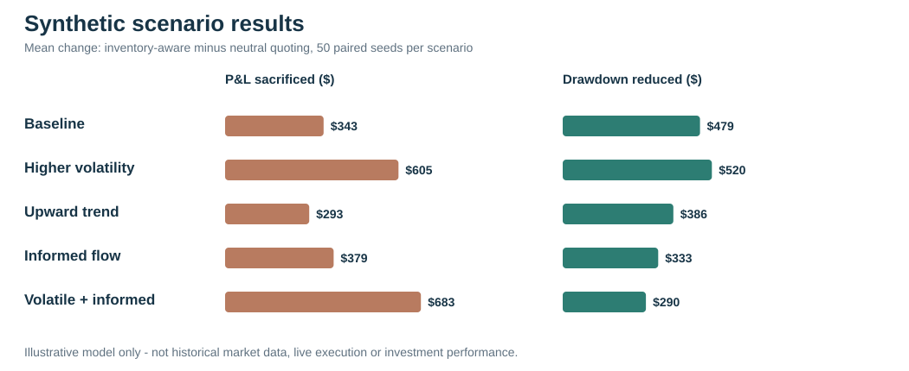

# Options Market-Making Simulator

A reproducible Python research project modelling an **inventory-aware options market maker**, with synthetic order flow, simplified Black-Scholes option prices, delta hedging, transaction costs and an SQLite audit trail. Compares risk-aware quotes with neutral quotes on **the same simulated market**.

**[Implementation](market_maker.py) · [100-seed robustness sweep](seed_sweep.py) · [Stress & sensitivity laboratory](stress_lab.py) · [Research note](reports/stress_lab_research_note.md) · [Tests](tests/) · [SQL analytics](sql/report_queries.sql) · [Reference runs](reports/seed42_summary.json)**

## What it demonstrates

- **Options pricing:** European-call Black-Scholes premium and analytical delta, checked against a finite-difference delta test.
- **Market making:** configurable bid/ask spreads, order-arrival/fill model, position limits and inventory-skewed quotes.
- **Risk controls:** periodic delta re-hedging, share and option position tracking, explicit execution costs and terminal liquidation.
- **Research design:** paired comparison using *common random numbers* for identical underlying price paths, customer directions and fill draws.
- **SQL / auditability:** persistent tables for runs, option fills, hedges and every mark-to-market observation; three reusable SQL queries.
- **Reproducibility:** fixed seeds, Python standard library only, 19 unit tests, JSON/CSV reporting and seed-level bootstrap intervals.
- **Stress testing:** five controlled synthetic scenarios, nine one-factor sensitivity settings, five-step fill mark-outs and an explicit risk/return decision threshold.

## Run locally

Requires Python 3.10 or newer. No third-party packages or live exchange credentials are needed.

```bash
python market_maker.py --seed 42 --steps 1000 --output-dir outputs
python seed_sweep.py --seeds 100 --steps 1000 --output-dir outputs
python stress_lab.py --stress-seeds 50 --sensitivity-seeds 30 --steps 1000 --output-dir outputs
python -m unittest discover -s tests -v
# Optional, if sqlite3 CLI is installed:
sqlite3 -header -column outputs/trades.sqlite3 < sql/report_queries.sql
```

The first command writes `outputs/summary.json` and `outputs/trades.sqlite3`. The second writes a paired 100-seed statistical summary and row-level CSV. The third runs five synthetic stress scenarios and nine one-variable-at-a-time sensitivity settings, creating `outputs/stress_lab_summary.json` and `outputs/stress_lab_seed_detail.csv`. The `reports/` files record reference runs using these defaults. Results are generated from artificial data and are **not** trading predictions or evidence of a profitable live strategy.

## Model and assumptions

1. Spot follows geometric Brownian motion with mean-reverting stochastic volatility; the market maker uses a deliberately lagged volatility estimate. A fixed European call is valued using Black-Scholes. This simplified model ignores volatility smiles, dividends, early exercise, exchange quoting rules and discrete option contract specifications beyond the 100-share multiplier.
2. Each time step has a probability of one incoming customer order. Customer direction reacts to the contemporaneous simulated spot shock, creating adverse-selection pressure. The probability that an order fills depends on our quoted price relative to synthetic fair value. **This is an invented execution model, not a calibrated order-book model.**
3. The inventory-aware strategy moves both quotes down when long calls and up when short; neutral quotes have no position skew. Both enforce the same position limit. Trades incur option fees, and stock hedges incur a spread/slippage charge plus per-share fees.
4. P&L is cash + marked stock + marked options, with positions liquidated at the end and transaction costs deducted. Drawdown is measured in USD from marked equity peaks. A single run reflects **one stochastic path**; the separate multi-seed sweep reports paired outcomes under varied synthetic paths, not statistical evidence about live trading.
5. The two strategies receive the *same exogenous* market steps and random uniforms (common random numbers); endogenous inventory/quoting decisions legitimately generate different executions.

## Stress-test findings (new)



The additional [experiment and research note](reports/stress_lab_research_note.md) extends the baseline experiment without modifying its original generator. Across 50 paired paths in each of five stylised regimes, inventory-aware quotes produced **lower mean maximum drawdown but also lower mean P&L**. The largest sacrifice occurred under combined volatility and deliberately future-informed customer flow. Nine parameter settings study spread, quote skew, hedge frequency and inventory limits (30 paired paths per setting). The project now includes 19 passing unit tests, a seed-bootstrap interval estimator, and a five-step fill mark-out diagnostic. The results make a *risk-control trade-off*, not a real-market performance claim.

- [Detailed research note and decision rule](reports/stress_lab_research_note.md)
- [Full machine-readable results](reports/stress_lab_summary.json)
- [Generate the chart](visualize_stress.py) (standard-library Python)

## Further work

- Validate with licensed, historical option quotes/trades and timestamp-aligned, truly out-of-sample datasets.
- Replace the stylized flow process with licensed historical option quote/trade data; model partial fills, latency, exchange fees and queue priority.
- Add put options, volatility surfaces, gamma/vega limits, stress scenarios, and reconciliation against independently verified execution data.
- Build a small real-time monitoring dashboard with equity, inventory and hedge logs sourced from SQLite.

## Data and limitations

No market data, exchange connectivity or order-submission functionality is included. All results are synthetic. The reference run is a demonstration of software and research discipline, not investment advice or a claim of trading performance.
