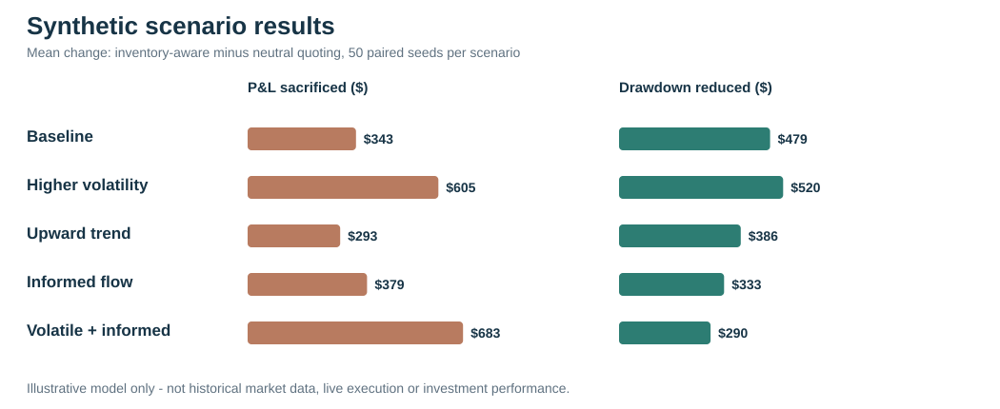

# Stress-test research note | 22 November 2026

## Research question

Does inventory-aware quote adjustment control tail risk enough to justify lower expected simulated P&L? How does that conclusion change under volatility, directional drift, and adversely selected order flow?

## Design

The [existing baseline simulator](../market_maker.py) is unchanged. The [stress laboratory](../stress_lab.py) reruns *both* strategies on exactly the same simulated input path, customer arrival draws, and fill draws. Five deliberately stylized market scenarios are tested over **50 paired paths of 1,000 steps each**. Separately, a **nine-setting one-variable-at-a-time sensitivity grid** tests 30 paired paths per setting. Reproducibility is controlled by fixed integer seeds.

| Experiment | Deliberate assumption |
|---|---|
| Baseline | Existing synthetic price/volatility/order-flow model |
| Higher volatility | Multiply cumulative log returns and quoted synthetic volatility by 1.65 |
| Upward trend | Apply +0.65 annualized log drift to the original synthetic path |
| Informed flow | Assign ~80% of customer direction draws to the sign of the *next simulated price move*; intentionally builds future-aware flow into the **generating process**, not the trader's model |
| Volatile + informed | Combine high volatility with future-informed customer direction |

The stress data are **not observed**. In particular, the future-informed scenario is deliberately adversarial and would be data leakage if presented as a forecast. Here it is an explicit model assumption about hypothetical informed customers.

## Findings

Values below are *inventory-aware minus neutral*; a negative P&L difference means **less money**, while a negative maximum-drawdown difference means **less downside**. The confidence intervals are percentile bootstrap intervals over simulated seeds, conditional on the model: they **do not** quantify live-market uncertainty.

| Scenario | Mean P&L change | Mean drawdown change | Fraction with lower drawdown | P&L change 95% seed-bootstrap interval |
|---|---:|---:|---:|---:|
| Baseline | -$343.48 | -$478.91 | 92% | [-$511.19, -$170.88] |
| Higher volatility | -$604.71 | -$520.25 | 90% | [-$861.24, -$376.64] |
| Upward trend | -$293.32 | -$385.87 | 84% | [-$473.97, -$122.63] |
| Informed flow | -$378.51 | -$332.94 | 84% | [-$531.17, -$234.03] |
| Volatile + informed | -$682.97 | -$290.23 | 80% | [-$929.71, -$445.93] |

**Decision implication:** A risk manager should not choose inventory-aware quotes solely because they reduce drawdown. With the arbitrary utility rule \(U=\bar{P\&L}-\lambda\,\overline{\mathrm{max drawdown}}\), the baseline break-even drawdown penalty is approximately \(\lambda=0.717\) dollar of objective-function value per $1 of average drawdown. The volatile/informed scenario needs a much larger penalty, approximately \(\lambda=2.353\). These are hypothetical *preference thresholds*, not recommended real-world risk limits.

The [summary JSON](stress_lab_summary.json) contains additional results for all sensitivity settings, including bid/ask widths, skew coefficients, hedging frequencies, and inventory limits. The five-step fill mark-out diagnostic probes adverse-selection costs but is **not** a market calibration or a full risk-adjusted performance estimate.



## Reproduce

Requires Python 3.10+; no third-party packages needed.

```bash
python stress_lab.py --stress-seeds 50 --sensitivity-seeds 30 --steps 1000 --output-dir outputs
python visualize_stress.py
python -m unittest discover -s tests -v
```

Reference files were generated with those flags and all **19 automated tests passed**. The CSV records every seed-by-variant comparison; the JSON tracks the aggregate summaries and intervals.

## Limitations and next experiments

- Customer arrivals, fills, and knowledge of future moves are stylized; no exchange-level order book, latency, queue position, actual market-impact response, or exchange-specific fees are present.
- Only one European-call instrument and one particular position-management rule are modelled; funding, portfolio Greeks, volatility smile and put-call combinations are not represented.
- Bootstrap uncertainty is measured **within** the synthetic data-generation model. It is not evidence of a profitable trading strategy or robust inference about actual futures/options markets.
- One-variable-at-a-time comparisons may miss interactions. A next iteration should test factorial interactions and evaluate on appropriately licensed market data with timestamp-aligned inputs and explicit out-of-sample periods.
- The reports are code-generated outputs, and should be re-run if assumptions or strategy logic changes.
